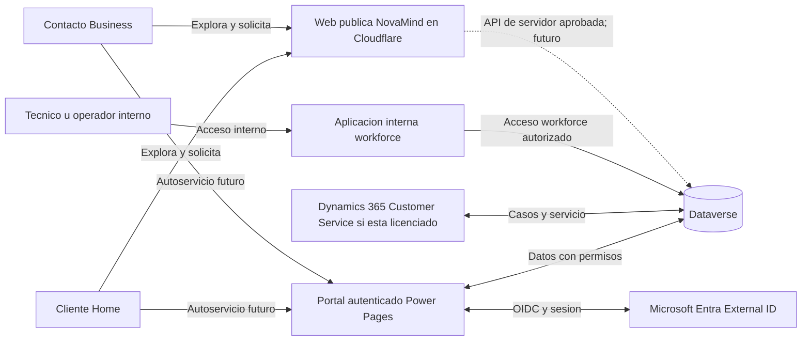
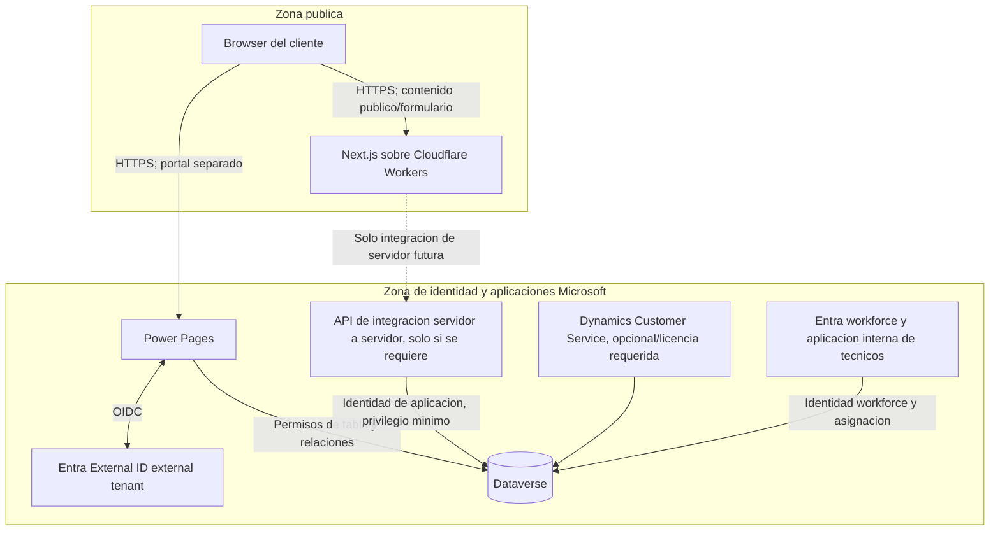
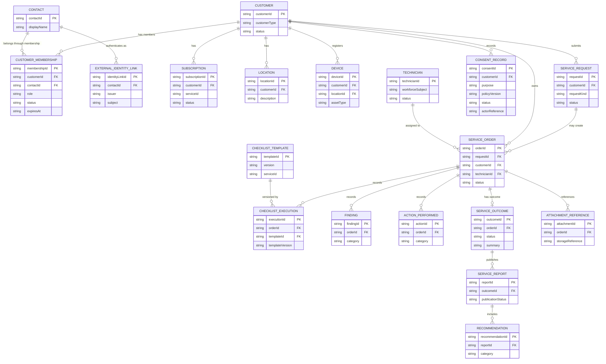

# Nova Assist Customer Portal Foundation

**Estado:** propuesta para decisión; no aprobada ni implementada  
**Fecha:** 2026-11-14  
**Alcance:** Home y Business customer self-service; no es diseño de producción ni autorización para crear recursos, identidades, tablas o integraciones.

## Architecture Decision Record

### Contexto

El repositorio actual es un sitio Next.js App Router desplegado en Cloudflare Workers mediante vinext. Los formularios de contacto validan y verifican Turnstile y actualmente entregan la solicitud por correo; las interfaces de CRM y operaciones son contratos TypeScript, sin persistencia. No se encontró autenticación de clientes, autorización por cuenta, almacenamiento de órdenes/reportes o binding de Dataverse. No se debe convertir el formulario público ni sus identificadores en acceso a información de clientes.

Nova Assist necesita dos dominios distintos: el sitio público de adquisición/solicitudes y, en el futuro, un espacio autenticado que muestre datos aislados por hogar o empresa. El portal requerirá identidad externa, pertenencia verificable, membresías/delegaciones, historial de servicio, permisos sobre adjuntos e informes, auditoría y procesos de privacidad.

### Decisión recomendada

**Arquitectura híbrida: mantener Next.js + Cloudflare como sitio público y usar Power Pages + Dataverse para el futuro portal autenticado**, sujeto a una prueba de concepto con información sintética, confirmación de licencias/región y aprobación de seguridad, privacidad, Legal y Operaciones.

- Mantener las rutas públicas y `/api/contact` actuales como canal de captación. No mostrarles información privada ni convertir una respuesta del formulario en una sesión autenticada.
- Crear el portal como superficie separada y bajo un origen/subdominio dedicado, si se aprueba. Power Pages autentica al usuario mediante Microsoft Entra External ID y usa Contactos de Dataverse, web roles y table permissions. Los casos existentes de Dynamics 365 Customer Service deben reutilizarse solo después de confirmar licencias, configuración y ajuste del modelo.
- Mantener técnicos y administradores en una superficie interna con identidad workforce de Microsoft Entra y roles internos; no reutilizar el portal público ni asignar permisos por el rol de cliente.
- Integrar el sitio público, portal, CRM y notificaciones mediante APIs de servidor aprobadas. Ninguna credencial Dataverse, token privilegiado ni secreto debe llegar al navegador.
- En la primera fase, portal de solo lectura y datos sintéticos. Abrir escritura, archivos, datos reales o autoservicio operacional en fases separadas.

La recomendación es una dirección de arquitectura, no un compromiso de licenciamiento o implementación. **No se selecciona una opción definitiva para producción hasta completar el PoC y las aprobaciones indicadas.**

### Alternativas consideradas

| Opción | Seguridad | Integración / Dataverse | Experiencia y flexibilidad | Costos y operación | Evaluación |
|---|---|---|---|---|---|
| Power Pages + Dataverse | Identidad y controles administrados; el acceso a registros requiere web roles y table permissions correctamente configurados. Sigue siendo necesario revisar cada tabla, relación, componente, búsqueda, archivo y ruta de renderizado. | Integración más directa con Contact, Account, casos y capacidades de plataforma. | Plantillas, formularios/listas y personalización low-code; menos control de interacción que Next.js y dependencia de patrones de Power Pages. | Categorías: capacidad MAU autenticada, Dataverse DB/archivos/logs, licencias Dynamics cuando aplique, construcción, pruebas y operación. Medir volumen y almacenamiento; no se estiman precios aquí. | Mejor alineación si el portal es primordialmente autoservicio de registros y el CRM oficial será Dataverse. |
| Next.js + Entra External ID + API propia | External ID resuelve identidad, no autorización de negocio. La aplicación debe construir y operar sesiones OIDC, CSRF, validación de tokens, aislamiento, autorización, adjuntos, auditoría, revocación y pruebas de IDOR. | Toda lectura/escritura CRM requiere API de servidor y adaptador; aumenta el número de componentes y la responsabilidad de seguridad. | Máximo control de marca, accesibilidad y flujos Home/Business; reutiliza la familiaridad del equipo con Next. | Categorías: MAU External ID, cómputo/API, almacenamiento, secretos, observabilidad, WAF, soporte, pruebas y mantenimiento de seguridad. | Elegir solo si los requisitos UX/negocio justifican asumir y financiar la capa de autorización y operación adicional. |
| Híbrida (recomendada) | Mantiene frontera clara: web pública no autenticada; portal administrado con permisos de registro; sistemas internos separados. La integración entre sistemas sigue necesitando revisión. | Next.js conserva adquisición; Power Pages ofrece acceso de cliente a Dataverse; API de servidor solo para brechas justificadas. | La marca pública conserva su diseño; el portal acepta las convenciones del producto Power Pages y limita duplicar funcionalidad. | Suma categorías de operación de dos superficies; evita construir desde cero todas las funciones del portal, pero puede incrementar configuración y gobierno. Validar TCO con tráfico, retención y capacidad reales. | Mejor balance provisional para el estado y objetivo del proyecto. |

No se recomienda iniciar un portal de autoservicio implementando OIDC, sesiones o autorización artesanal sobre Cloudflare. Azure AD B2C no es una opción de nueva compra para clientes nuevos desde el 1 de mayo de 2025; no debe seleccionarse para esta iniciativa nueva. Para Home y Business, usar el concepto de **External ID external tenant** para consumidores y clientes de negocio; la colaboración B2B de un workforce tenant está enfocada a socios/usuarios externos de la organización, no reemplaza automáticamente una estrategia CIAM de clientes. Se puede evaluar federación con el Entra tenant de un cliente Business en el PoC, sin confiar en claims de grupo como autorización de datos.

## C4: contexto y contenedores

Los diagramas siguientes son **objetivo propuesto**, no componentes desplegados.

### Contexto

### Contenedores propuestos

## Identity, autorización y aislamiento

### Identidad

- **Clientes Home y Business:** cuentas de clientes en External ID external tenant y una identidad de aplicación asociada a un Contact. Capturar solo claims necesarios para iniciar sesión. No asumir que el correo verificado implica pertenencia, autorización o que una cuenta existente puede fusionarse automáticamente.
- **Clientes Business con identidad corporativa:** investigar federación OIDC con el tenant del cliente en el PoC. Validar issuer, audience, tenant y política de aprovisionamiento; un dominio o claim controlado por el cliente no concede acceso a una cuenta Dataverse.
- **Técnicos y operadores:** workforce tenant, MFA/Conditional Access conforme a política corporativa, asignación de órdenes y acceso de soporte con justificación y auditoría. Las cuentas de cliente no obtienen rol de técnico.
- **Administración:** roles separados, MFA fuerte, acceso just-in-time/PIM cuando esté disponible, cuenta de emergencia controlada y auditoría. Ningún administrador diario debe usar credenciales compartidas.
- **Sesión:** preferir la sesión administrada por Power Pages. Si el PoC justifica Next.js autenticado, usar una biblioteca OIDC compatible y sesiones server-side/HttpOnly, Secure, SameSite, PKCE/state/nonce, rotación y revocación. No almacenar tokens en `localStorage`, no implementar almacenamiento de contraseñas ni flujos OAuth propios.

### Principios de autorización

1. Resolver el sujeto desde la sesión validada del proveedor, nunca de `customerId`, `accountId`, `contactId`, `orderId` o rol enviados por el navegador.
2. Autorizar cada lectura/escritura en el servidor a partir de membresías activas y relaciones persistidas. Para identificadores anidados, validar que cada registro pertenece al mismo Customer autorizado.
3. Toda fila operativa debe estar ligada a un Customer y, cuando aplique, una orden. Las relaciones de hijos deben impedir cambiar el Customer de padre o vincular datos cruzados.
4. Denegar por defecto. No crear permisos globales para solicitudes, órdenes, dispositivos/endpoints, reportes, recomendaciones, consentimientos o adjuntos.
5. Las pertenencias y delegaciones son datos de autorización: estado, alcance, actor que aprobó, fecha de vigencia y revocación. El email coincidente no es prueba de membresía.
6. Separar permisos de lectura, creación, actualización, cierre/exportación y administración. No permitir que el portal modifique propietario, Customer, técnico asignado, estado interno, resolución o auditoría.
7. El acceso del técnico requiere asignación vigente o permiso excepcional documentado. Acceso de soporte debe caducar y registrar motivo/actor/recursos.
8. Revalidar permisos al descargar archivos/reportes; no confiar en que ocultar un botón proteja una fila o archivo.

### Matriz de autorización preliminar

`R` leer; `C` crear; `U` actualizar campos expresamente habilitados; `A` administrar/asignar; `-` denegado. En Power Pages, la matriz debe implementarse con web roles y table permissions verificables por fila, no como una tabla decorativa.

| Recurso/acción | Miembro Home activo | Miembro Business activo | Delegado autorizado | Técnico asignado | Service Desk interno | CRM admin |
|---|---:|---:|---:|---:|---:|---:|
| Perfil del hogar/empresa y membresía | R | R | R limitado al alcance delegado | R mínimo operativo | R con necesidad laboral | A auditado |
| Suscripciones/servicios del Customer | R | R | R según concesión | R si la orden lo requiere | R según asignación | A auditado |
| Dispositivos/endpoints | R limitado | R limitado | R según concesión | R mínimo por orden | R según asignación | A auditado |
| Solicitudes propias/de su Customer | R, C | R, C | R/C solo si el scope lo concede | R de órdenes asignadas | R/U según función | A auditado |
| Caso/orden asignada | R estado visible al cliente | R estado visible al cliente | R según concesión | R/U operativo por asignación | R/U por función | A auditado |
| Checklist interno, nota técnica, evidencia | - | - | - salvo aprobación explícita por campo | R/C/U en orden asignada | R/C/U por función | A auditado |
| Reportes/recomendaciones publicables | R si publicados al Customer | R si publicados al Customer | R si scope incluye reportes | C; R por orden asignada | R/U por proceso | A auditado |
| Adjuntos del portal | R/C propios dentro de caso permitido | R/C propios dentro de caso permitido | R/C según scope | R/C según orden | R/C según función | A auditado |
| Tarifas, datos de otros Customers, configuración interna | - | - | - | - salvo excepción | mínimo requerido | A auditado |

El usuario `CRM admin` no equivale a acceso de negocio cotidiano. Cada columna necesita un rol aprobado y pruebas negativas de acceso cruzado.

### Delegación Home y Business

- Home: miembro adulto/propietario y delegado familiar deben ser roles de membresía distintos; la delegación es explícita, con scopes granulares (por ejemplo, solicitudes vs. dispositivos), vencimiento y revocación. No inferir tutela, residencia ni autoridad por apellido o dispositivo compartido.
- Business: el administrador de cuenta puede proponer/invitar miembros autorizados; aprobación del Customer/administrador debe ser verificable. Separar contacto de facturación, contacto técnico y solicitante solo si el negocio lo requiere.
- Impersonation: no ofrecer “entrar como cliente” sin flujo break-glass, motivo requerido, vista visible, tiempo límite y audit trail.

## Modelo de datos lógico

`Customer` es el límite de aislamiento de datos para un hogar o una organización. Puede mapear a una Account de Dataverse o a una entidad de cliente acordada durante el diseño. Las cardinalidades y campos son lógicos; no se crean tablas con este documento.

<!-- mermaid-checked: every attribute is `<type> <name> [<key>] ["<description>"]` with at most one of PK/FK/UK, no \n in descriptions, no {} in descriptions, every relationship label is double-quoted -->

#### Invariantes de datos

- `CustomerMembership` es el source of truth de hogar/empresa y delegación; vincula `Contact` a un único `Customer` por membresía. Un Contact puede tener múltiples membresías aprobadas, pero cada consulta debe seleccionar la activa y autorizada.
- `ExternalIdentityLink` usa el par issuer + subject inmutable del IdP como enlace; no fusionar identidad únicamente por correo. El proveedor puede cambiar el correo del usuario. Issuer y subject son identificadores seudónimos sensibles y necesitan acceso/retención controlados.
- Guardar referencias a identidad con minimización de claims. No persistir tokens, contraseñas, MFA, secretos, claves de recuperación ni respuestas de autenticación.
- `ServiceRequest` conserva procedencia y clasificación; `ServiceOrder` debe conservar el Customer redundante con regla de integridad, para filtrar y probar aislamiento además de navegar la relación padre.
- Checklist template versionada e inmutable para ejecución histórica; el resultado debe apuntar a la versión exacta aplicada.
- Una recomendación/reporte solo se expone al cliente tras un estado explícito de publicación y autorización por Customer. Las notas internas, hallazgos sensibles y detalles técnicos requieren clasificación y campos separados.
- `AttachmentReference` no es una URL de descarga. Guardar identificador opaco del objeto/archivo, tipo/tamaño/hash si se aprueba, clasificación, vínculo al Customer/orden, estado de antivirus y retención; resolver acceso con autorización en cada lectura.
- Las tablas de auditoría no se borran junto con el Customer sin analizar retención legal y obligaciones de auditoría. Definir anonimización/pseudonimización cuando la eliminación física no proceda.

## Mapa de rutas futuro

Mapa de producto conceptual; **no existe todavía y no se añaden rutas en el sitio**. La superficie separada podría usar un host de portal aprobado, con navegación interna tipo:

| Segmento | Rutas conceptuales |
|---|---|
| Identidad | `/sign-in`, `/sign-out`, `/account` (gestión y recuperación delegada al IdP) |
| Común | `/`, `/requests`, `/requests/{requestId}`, `/orders/{orderId}`, `/orders/{orderId}/reports/{reportId}`, `/recommendations`, `/profile`, `/privacy` |
| Home | `/home/plan`, `/home/devices`, `/home/visits`, `/home/technology-profile` |
| Business | `/business/services`, `/business/cases`, `/business/endpoints`, `/business/projects`, `/business/documentation` |
| Técnico interno, superficie diferente | `/work/assigned`, `/work/orders/{orderId}`, `/work/orders/{orderId}/checklist`, `/work/orders/{orderId}/outcome` |

Los identificadores son nombres de ruta ilustrativos, no secretos ni capacidades bearer. Si se usa Power Pages, las páginas y listas se configuran mediante el producto; mantener estas rutas como mapa UX, no promesa de URLs exactas.

## Contrato API futuro

No se implementa una API portal en esta fase. Power Pages debe preferir formularios/listas y permisos nativos para operaciones soportadas. Solo agregar API de integración server-side cuando un requisito no pueda cubrirse con capacidades estándar. Todo contrato futuro debe exigir sesión válida, protección CSRF para mutaciones, autorización por fila y contrato de salida limitado.

### Reglas del contrato

- El cliente nunca determina el Customer autorizado. El servidor obtiene sujeto de la sesión y resuelve las membresías activas.
- Aceptar `requestId`, `orderId` o `reportId` solo como selector opaco; volver a verificar relación y permiso en cada operación.
- No aceptar `customerId`, `contactId`, `technicianId`, `ownerId`, privilegios, estado interno, URL de archivo ni valores de rol como autoridad del navegador.
- Respuestas solo incluyen campos publicados al cliente. Excluir notas técnicas internas, secretos, detalles de infraestructura y PII de otros miembros.
- Limitar tamaños, rate limits, paginación, carga/descarga y formatos; registrar request/correlation ID aleatorio, actor interno seudónimo, Customer resuelto y acción, sin token ni texto de formulario.
- Respuestas estándar: `401` sesión ausente/no válida; `403` acceso denegado; `404` recurso no visible para evitar revelar existencia; `409` conflicto de estado; `413` tamaño excedido; `422` validación; `429` límite; `5xx` error genérico y correlación.
- Mutaciones con idempotency key solo si se define persistencia e idempotencia; no reportar creación confirmada antes de guardar. Descargas privadas no usan URL pública predecible ni SAS anónimo de vida larga.

### Recursos conceptuales

| Operación lógica | Entrada mínima | Salida permitida | Autorización |
|---|---|---|---|
| Leer resumen de Customer actual | Ninguna; scope desde sesión | nombre/servicios publicados y conteos permitidos | membresía activa; selector server-side |
| Listar solicitudes | filtros/paginación no autoritativos | solicitudes del Customer en sesión | pertenencia activa y Customer resuelto por servidor |
| Crear solicitud | servicio, campos validados y consentimiento aplicable | id opaco, estado recibido y request ID | miembro con permiso de creación; validación y rate limit |
| Leer caso/orden | id opaco | estado visible, hitos y técnico solo si política permite | Customer de la fila coincide con membresía |
| Leer reporte publicado | id opaco | documento/datos publicados | Customer coincide, estado publicado, registro de descarga |
| Descargar adjunto | id opaco | stream privado de archivo | autorización repetida, clasificación, escaneo y auditoría |
| Delegar/revocar miembro | invitación, scope, expiración | estado de invitación, sin revelar identidad existente | propietario/administrador autorizado, comprobación adicional para Home |
| Actualizar checklist/resultado (interno) | campos permitidos, versión, concurrencia | resultado y audit ID | workforce + asignación vigente; no endpoint cliente |

## Threat model resumido

| Amenaza | Activo / impacto | Controles propuestos y pruebas obligatorias |
|---|---|---|
| IDOR / cambio de Customer ID | Exposición o alteración de datos entre hogares/empresas | Ignorar Customer ID cliente como autoridad; filtro de membresía server-side; pruebas A/B de objeto directo para toda relación y attachment. |
| Permiso global o relación padre mal configurada | Fuga de tabla/lista completa en Power Pages | Denegar por defecto; no permisos globales operativos; revisión de web roles/table permissions, child permissions y paths Liquid/search/forms/API; prueba anónimo y de usuario ajeno. |
| Account/contact linking por email | Apropiación de historial o fusión de perfiles | Enlace issuer+subject, proceso de invitación/claim explícito y verificado, no auto-link solo por email; registrar cambios. |
| Abuso de invitación o delegación | Suplantación de familia/empleado y persistencia de acceso | Invitación verificable, scope limitado, expiración, revocación inmediata, reautenticación para cambios sensibles y auditoría. |
| Token/sesión robada, CSRF o logout incompleto | Suplantación de sesión | IdP administrado, cookies seguras, PKCE/state/nonce donde aplique, CSRF y CORS restrictivos, expiración/rotación, revocación y pruebas de logout. |
| Técnico con acceso excesivo | Fuga de datos cliente o abuso interno | Identidad workforce separada, acceso por asignación/caso, least privilege, MFA, acceso break-glass temporal, auditoría y revisiones periódicas. |
| Reporte o adjunto con URL adivinable/cacheable | Exposición de datos, configs o documentos | Descarga autenticada con autorización por fila; storage privado; no URLs predecibles; control de caché, antivirus/tipo/tamaño y pruebas anónimas/entre clientes. |
| Notas/recomendaciones contienen secretos o información excesiva | Exposición de credenciales, vulnerabilidades o datos de terceros | Prohibir credenciales/tokens; separar interno vs publicable; aprobación de publicación; minimización y redacción. |
| Exportación/retención fuera de política | Incumplimiento de privacidad y fuga persistente | Inventario de datos, retención por categoría, auditoría de exportaciones, revisión legal de DSAR/holds y borrado verificable de copias/adjuntos. |
| App registration o integración privilegiada comprometida | Acceso masivo a Dataverse | Identidad de aplicación dedicada, privilegio mínimo por tabla/operación, credenciales en vault, rotación, entornos separados, alertas y revocación. |
| DoS/spam en solicitudes, archivos o búsquedas | Indisponibilidad/costo operacional | Rate limits por identidad y red, límites de carga/paginación, protección WAF, límites y monitoreo de MAU/capacidad/costos. |
| Analytics, logs o referer incluyen PII | Exposición secundaria y difícil de borrar | Allowlist de telemetría, rutas sin query, redacción de logs, no PII/adjuntos/tokens; verificar requests de red y retención. |

## Privacidad, evidencias y notificaciones

- **Clasificación:** Contact/name/email y contenido de solicitudes son PII; issuer/subject de identidad y membership también son identificadores personales seudónimos. Inventario de endpoints, hallazgos, recomendaciones y reportes pueden revelar postura/configuración de seguridad y son información operacional confidencial. El modelo no requiere PHI ni PCI; si un servicio futuro los necesita, abrir evaluación y minimización separadas. Aún no hay cifrado, masking, retención ni control de acceso de portal configurados porque no existe almacenamiento de portal.
- **Consentimiento:** guardar propósito específico, texto/versión presentado, actor, fecha y estado de consentimiento. Distinguir consentimiento de tratamiento necesario de comunicaciones comerciales opcionales. No reutilizar el consentimiento del formulario de leads como consentimiento general del portal.
- **Acceso/corrección/descarga/eliminación:** proceso autenticado de solicitud y verificación de identidad/membresía; registrar alcance, fecha, resultado y sistemas consultados. Definir excepciones legales, auditoría y litigio con Legal; no prometer borrado que no se ha verificado.
- **Retención:** acordar períodos por solicitudes, casos, órdenes, reportes, adjuntos, identidad, auditoría y eventos. Aplicar borrado o anonimización según obligación y conservar registro de acciones. Evitar definir períodos sin aprobación.
- **Evidencias y adjuntos:** restringir extensiones y tamaños, inspección de malware, cifrado en reposo/transporte, metadatos mínimos, acceso por orden y Customer, ubicación/región aprobada, retención y borrado de versiones/copias. No adjuntar contraseñas, códigos MFA, tarjetas ni secretos.
- **Reportes:** separar contenido interno del publicable; revisión humana/aprobación; solo transmitir el reporte publicado al miembro con scope adecuado; descargar con autorización y auditoría, respuesta cache-control privada/no-store según diseño.
- **Notificaciones:** incluir aviso mínimo y enlace al portal, sin copiar hallazgos o PII sensible en email/analytics. El link no debe funcionar como credencial de acceso; el usuario debe autenticarse.
- **Auditoría:** registrar quién/qué/cuándo/resultado y Customer de contexto, lectura/exportación de datos sensibles y cambios de membresía, asignación, publicación, consentimiento y acceso excepcional. Validar retención, acceso a logs y costo.

## Plan por fases y backlog

| Fase | Entregables | Criterio de salida / bloqueo |
|---|---|---|
| 0. Decisiones y descubrimiento | Confirmar fuente CRM, D365/licencias existentes, Customer/Account ownership, Home membership, clientes empresariales federados, región, privacidad, retención, perfiles de acceso, tráfico y soporte esperado. Definir owner de identidad, datos, operación y presupuesto. | No avanzar con datos reales si faltan propietario del dato, aislamiento, privacidad o presupuesto de operación. |
| 1. PoC aislado | Entorno sandbox no productivo; External ID external tenant de prueba y Power Pages; identidad sintética, dos Customers ficticios y usuarios de cada rol; una tabla no sensible; demostrar login/logout, asociación contact, permisos por registro y pruebas cross-customer. | Revisión de arquitectura/seguridad; 0 acceso anónimo/entre clientes; revisar licencias/capacidad y costo categórico observado. Destruir o retener datos de prueba conforme a política. |
| 2. Modelo y CRM | Aprobar logical-to-Dataverse mapping, ownership, estados, relaciones, solución ALM, ambientes y versionado; mapear entrada del sitio público a CRM mediante adaptador server-side con idempotencia, reconciliación, cola/outbox si se aprueba. Mantener email fallback solo según decisión operacional. | Aprobación de CRM owner y política de fallas/duplicados; datos existentes migrados solo mediante plan independiente. |
| 3. Portal cliente read-only | Servicios/suscripciones, dispositivos/endpoints autorizados, solicitudes/casos y reportes publicados; membresía y roles; logging/auditoría; pruebas de accesibilidad y seguridad. | Sin escritura operacional; pruebas IDOR directas, exportación, acceso revocado y attachments; aprobación de privacidad y soporte. |
| 4. Autoservicio de solicitudes y delegación | Crear/consultar solicitudes, invitaciones/delegación y perfil con campos permitidos; notificaciones mínimas; gestión de preferencias/consentimiento. | Revisar abuso, idempotencia, CSRF, rate limits, duplicados, privacidad y flujos de recuperación antes de habilitar a clientes. |
| 5. Operaciones y técnico | Órdenes, asignación, checklists versionados, hallazgos, acciones, publicación de resultado/recomendación en superficie interna workforce. | RBAC workforce y acceso por asignación demostrados; auditoría de ediciones; proceso de aprobación de reportes. |
| 6. Archivos y expansión | Cargas privadas, escaneo, descarga controlada, retención/DSAR automatizados; analítica agregada sin PII; evaluar Home Technology Profile y casos Business adicionales. | Evaluación de amenaza y privacidad específica, costo/capacidad aceptados y pruebas de borrado/descarga/caché. |

## Costos y operación a estimar (sin importes)

No hay precios ni volúmenes aprobados. Para el análisis financiero recopilar:

- Capacidad de Power Pages por tipo de usuario autenticado/MAU, sitios y demanda pico; validar modelo actual y requisitos de compra con el partner/representante.
- Costos de Dataverse: capacidad de base de datos, archivos y logs; crecimiento por notas, reportes, auditoría y adjuntos.
- Licenciamiento Dynamics 365 Customer Service/Power Platform y derechos de uso de tablas/funciones que realmente se requieran.
- Entra External ID: MAU, métodos de autenticación, add-ons y configuración de tenant; separar clientes Home/Business y usuarios internos.
- Integración server-side: hosting/API, conectividad, gestión de secretos, observabilidad, protección contra abuso, colas, soporte, ambientes y recuperación.
- Construcción inicial, personalización, migración/limpieza, seguridad/penetration test, accesibilidad, capacitación, gobierno de ALM y soporte recurrente.
- Operación: administración de usuarios/membresías, revisión de accesos, atención de DSAR, monitoreo de abuso, renovación/expiración de delegaciones, control de capacidad y respuesta a incidentes.

La página pública de precios de Microsoft presenta opciones de capacidad de Power Pages autenticada y anónima, pero importes, disponibilidad, impuestos, moneda, región, términos y condiciones pueden cambiar. Entra External ID documenta facturación basada en usuarios activos mensuales con add-ons. Este ADR no copia cifras y requiere cotización/validación actual en el tenant y región aprobados.

## Preguntas y prerequisitos de decisión

1. ¿Dataverse será el sistema autorizado para Customers, casos, órdenes, reportes y membresías, o CRM solo recibirá leads?
2. ¿Existe una instancia/licencia de Dynamics 365 Customer Service y quién administra sus tablas/casos/colas?
3. ¿Cómo se representa un hogar: Account tipo hogar, Customer custom u otro patrón soportado por el CRM? ¿Quién puede invitar y delegar?
4. ¿Qué organizaciones Business deben poder federar su propio Entra tenant y cómo se verificará su Account?
5. ¿Cuáles campos/reportes pueden publicarse a Home/Business y cuáles permanecen internos?
6. ¿Qué región, residencia, retención y capacidad se requieren para Customer, contactos, endpoint inventory, auditoría y archivos?
7. ¿Qué volúmenes de usuarios MAU, solicitudes, adjuntos y concurrencia se esperan? Obtener datos/cotización para TCO.
8. ¿Quién es el dueño operativo de identidad, soporte de cuenta, autorizaciones, incidentes, DSAR y ciclo de vida de técnico?
9. ¿Hay requisitos de disponibilidad, soporte, accesibilidad, idioma y recuperación que afecten el diseño?
10. ¿Qué consentimiento/privacy notice se presentará y cuál es su relación con el consentimiento de contacto ya implementado?

## Referencias oficiales

Consultadas el 2026-11-14; revisar de nuevo en el PoC porque licencias y características cambian.

- [Microsoft Entra External ID: overview for customer identity and access management](https://learn.microsoft.com/en-us/entra/external-id/customers/overview-customers-ciam)
- [Microsoft Entra External ID: workforce and external tenant configurations](https://learn.microsoft.com/en-us/entra/external-id/tenant-configurations)
- [Microsoft Entra External ID: supported features by tenant type](https://learn.microsoft.com/en-us/entra/external-id/customers/concept-supported-features-customers)
- [Microsoft Entra External ID pricing and billing overview](https://learn.microsoft.com/en-us/entra/external-id/external-identities-pricing)
- [Power Pages: configure Microsoft Entra External ID](https://learn.microsoft.com/en-us/power-pages/security/authentication/entra-external-id)
- [Power Pages security model](https://learn.microsoft.com/en-us/power-pages/security/power-pages-security)
- [Power Pages table permissions](https://learn.microsoft.com/en-us/power-pages/security/table-permissions)
- [Power Pages security best practices](https://learn.microsoft.com/en-us/power-pages/security/security-best-practices)
- [Power Pages connectivity to Dataverse](https://learn.microsoft.com/en-us/power-pages/admin/connectivity)
- [Power Pages customer case management](https://learn.microsoft.com/en-us/power-pages/templates/dynamics-365-apps/case-management)
- [Dataverse auditing](https://learn.microsoft.com/en-us/power-platform/admin/manage-dataverse-auditing)
- [Power Pages pricing and capacity](https://www.microsoft.com/en-us/power-platform/products/power-pages/pricing/)
- [Azure AD B2C product availability FAQ](https://learn.microsoft.com/en-us/azure/active-directory-b2c/faq)
